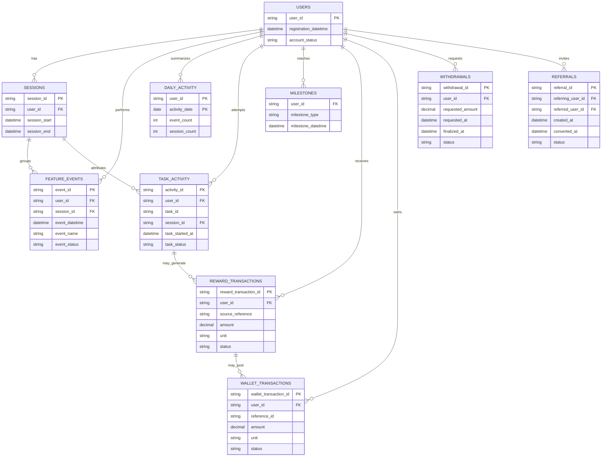

# D10 — Logical Data Model

**Status:** proposed logical model based on the assignment and simulated sheet structure; engineering must confirm keys and cardinalities.

## Relationship notes

- Users to sessions/events/tasks/daily activity are proposed one-to-many relationships.
- Sessions to events/tasks are proposed one-to-many; a task may be session-attributable only when the source provides a valid session key.
- Reward and wallet records are transaction entities. Reversals/corrections reference prior transactions; they must not overwrite original events.
- Referrals are a relationship between two user roles and require a distinct referral ID. The invitee may be unknown before registration.
- Many-to-many relationships should use an explicit bridge entity if the product permits multiple attribution sources, task assignments, or referral relationships.

## Evidence and approval

Ten candidate links in the supplied simulated workbooks had zero orphan rows. This is a dataset-level check only. Primary-key uniqueness, event cardinality, late-arriving records, and production foreign-key constraints require owner review. Reward, wallet, withdrawal, and referral entities are proposed and absent from the source workbooks.